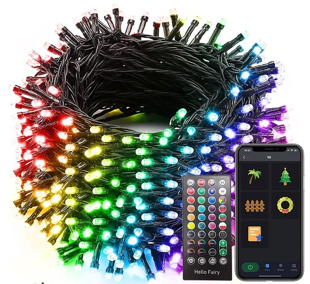

# Hello Fairy Bluetooth Lights Integration for Home Assistant



This custom integration allows you to control Hello Fairy Bluetooth LED string lights from Home Assistant. The integration supports full RGB color control, brightness adjustment, and all built-in animated effects.

## Features

- **ConfigFlow**: Automatically detect Hello Fairy bluetooth string lights.
- **Full RGB Color Control**: Set any color using RGB values
- **Brightness Control**: Adjust brightness from 0-100%
- **Effect Support**: Listed 14 of my favorites of the ~58 effects options
- **Remote Status**: Automatically syncs with device state changes from remote control. Hopefully.

## Supported Devices

This integration works with Hello Fairy Bluetooth LED string lights that advertise with the name pattern `Hello Fairy-*`.  These used to be sold directly under the "Hello Fairy" brand; now I seem to find them under different names such as "Minetom". I'm not sure if the bluetooth identifier has changed as well, but hopefully these will be autodetected as well. If your Bluetooth string lights are controlled via the Hello Fairy app, they will likely work with this integration.

## Requirements

Version 2.0 requires Home Assistant **2026.9.3 or newer**, for both string lights and curtains.

These lights are controlled via Bluetooth Low Energy. Your Home Assistance instance needs a way to send Bluetooth signals. See the [Bluetooth integration](https://www.home-assistant.io/integrations/bluetooth/).

## Installation

### 1. Install

Choose one of the following methods to install the integration:

A. Install via HACS (Recommended)
   - Open Home Assistant and click on **HACS** in the sidebar.
   - Search for **"Hello Fairy"** and select it.
   - Click **"Download"**.

B. Install manually
   - Copy the `custom_components/hello_fairy_ble` folder to your Home Assistant `config/custom_components/` directory

### 2. Configure
   - **Restart Home Assistant**.
   - After restarting, navigate to **Settings > Devices & Services**.
   - Click **"Add Integration"**, find **"Hello Fairy Bluetooth Lights"**, and follow the prompts.

The integration uses [Bluetooth discovery](https://www.home-assistant.io/integrations/bluetooth/) to automatically find Hello Fairy devices within Bluetooth range.

## Usage

Once configured, your Hello Fairy lights will appear as a light entity in Home Assistant with the following capabilities:

- **On/Off Control**: Turn lights on and off
- **RGB Color**: Set custom colors using the color picker
- **Brightness**: Adjust brightness with the brightness slider
- **Effects**: Choose from 14 built-in effects in the effect dropdown
- **Preset**: There is also a separate numerical control to select any of the full range of effects by number

### Available Effects

The integration includes the following preset effects in the light effects dropdown. You can also use the separate 'preset' control to select any of the other presets.

- Blue White Dissolve
- Blue Sparkle
- White Sparkle
- Blue with Pink Sparkle
- Fireworks
- Xmas
- Candy Cane
- Halloween
- Red Gold
- July 4th
- Valentine
- St. Patrick
- May Day
- Snow Day

***

# Technical Implementation

This integration implements the Hello Fairy protocol I initially worked out for an [ESPHome project](https://community.home-assistant.io/t/control-hello-fairy-ble-string-lights-with-esphome/818595). My conclusion there is that really I should have written a Home Assistant *Integration* rather than custom ESP32 yaml; not only is all the send/ack/notify stuff already mostly handled in the HA libraries, but also you get to use any/all of your Bluetooth proxies (e.g. ESP32's configured with esphome.bluetooth-proxy) automatically, instead of hard-coding a specific MAC into a specific ESP.

So, a year later, here is that integration (my first).

### Protocol Details

- **Service UUID**: `49535343-fe7d-4ae5-8fa9-9fafd205e455`
- **Command UUID**: `49535343-8841-43f4-a8d4-ecbe34729bb3`
- **Notify UUID**: `49535343-1E4D-4BD9-BA61-23C647249616`

### Command Format

Commands use the following structure:

- `0xAA` (prefix) + command type + length + data + checksum

### Power Commands

- **On**: `AA 02 01 01 AE`
- **Off**: `AA 02 01 00 AD`

### Color Commands

- **HSV Color**: `AA 03 07 01 HHHH SSSS VVVV CC`
  - H: Hue (0-359 degrees, 2 bytes)
  - S: Saturation (0-1000, 2 bytes)
  - V: Value/Brightness (0-1000, 2 bytes)
  - CC: Checksum

### Preset Commands

- **Effect**: `AA 03 04 02 PP VVVV CC`
  - PP: Preset number (1-58)
  - VVVV: Brightness (0-1000, 2 bytes)
  - CC: Checksum

### Status Notifications

The device sends status updates via BLE notifications when state changes from the remote. Curtain Studio can also explicitly request status using command `01`; reported fields depend on the device profile.

- Power state (byte 6): `00` = off, `01` = on
- Mode (byte 7): `01` = color mode, `02` = preset mode
- Color data (bytes 8-13): HSV values when in color mode
- Preset data (bytes 8-10): Preset number and brightness when in preset mode

## Version 2.0: Adds Curtain Studio support

Version 2.0 includes Curtain Studio inside this integration for supported 400-LED, 20×20 curtains. The string-light controls described above remain available. Other lights may appear in Studio, but unsupported DIY operations are rejected without disabling their ordinary controls.

Studio provides image import, painting, patterns, text, saved designs, multi-curtain layouts, playlists, favorites, clock/message displays, orientation corrections and library backup/import. Supported curtains can use native two-picture animation, movement, speed and brightness. Additional native music, clock, countdown and schedule controls require the documented device profile and capability checks.

### Installation and compatibility

Version 2.0 requires Home Assistant **2026.9.3 or newer**. Back up the existing integration folder, install the complete `custom_components/hello_fairy_ble` folder, restart HA and refresh the browser. Keep existing configured devices. Open **Curtain Studio** in the sidebar as an administrator; the header should show **2.0.0**. This PR is awaiting merge/release; HACS will offer it after the maintainer publishes it.

DIY uploads require verified ATT MTU ≥245 and at least 242 bytes per write. The tested ESPHome 2026.9.1 proxy reported MTU 512 and capacity 509 after fresh verification. The integration reproduces the captured Android six-packet transfer and refuses unsupported capacity; it does not probe oversized writes or fall back to many tiny image packets. Standard light controls remain available when DIY is unsupported.

Commands are serialized. Connection setup uses bounded retries, but uncertain writes and partial image transfers are not replayed. A valid manual request stops background Studio playback; invalid payloads or missing targets leave that playback running. On failure, check the lights before deliberately sending again.

### Guides and limits

See [STUDIO_GUIDE.md](STUDIO_GUIDE.md) for all controls, automation actions and backups, [PROTOCOL.md](PROTOCOL.md) and [NATIVE_EVIDENCE.md](NATIVE_EVIDENCE.md) for protocol evidence, and [VALIDATION.md](VALIDATION.md) for tests and hardware reports.

Device reports are separate from upload history and local previews. Full pixel readback and synchronized cross-curtain movement are unproven. Native font uploads, extra device storage, true firmware pause and scene loops remain unavailable. Native schedules use a fixed offset and need review after timezone/DST changes. These limits do not affect the ordinary string-light controls.

For troubleshooting, close the phone app if it holds the Bluetooth connection and use the debug logging configuration below. If Studio is missing, check that HA loaded the integration and that the account is an administrator. For rollback, restore the backed-up integration folder and restart HA without deleting configured devices.

## Troubleshooting

### Device Not Discovered

1. Ensure the Hello Fairy lights are powered on and *not already connected to your phone app*
2. Try power cycling the Hello Fairy lights
3. Check that Bluetooth is enabled on your Home Assistant host or Bluetooth proxies
4. Verify the device name starts with "Hello Fairy-" (in the logs)
5. Try turning on logging and restarting Home Assistant:

```console
logger:
  default: warn
  logs:
    custom_components.hello_fairy_ble: debug
    #   for even more debug info, turn on
    # bleak: debug
    # homeassistant.components.bluetooth: debug
```

### Effect Not Working

1. Make sure the device is turned on before applying effects
2. Some effects may take a moment to activate
3. Try switching between color mode and effect mode

## Contributing

This integration is based on the protocol reverse-engineering work originally from my [`fairy.yaml` ESPHome configuration](https://community.home-assistant.io/t/control-hello-fairy-ble-string-lights-with-esphome). Contributions and improvements are welcome!

## License

This project is provided as-is for personal use. Please respect the original device manufacturer's terms of service.
